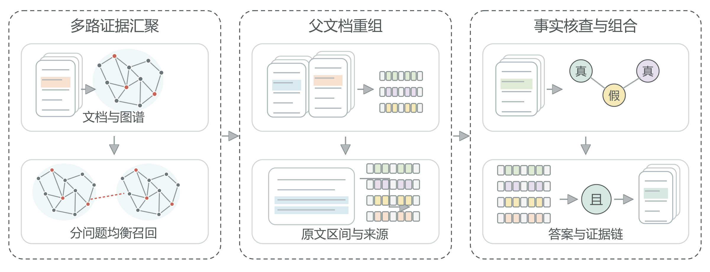
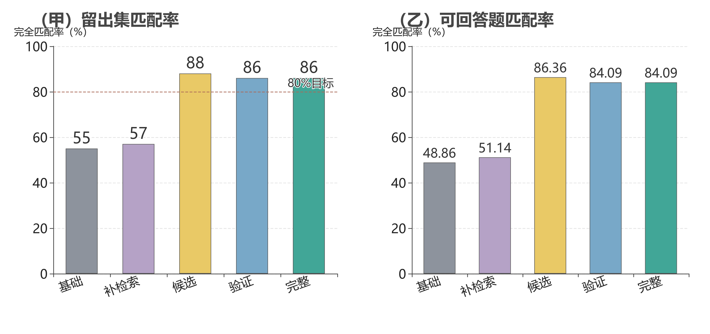

# 观微证据链 · EvidenceChain-RAG

**让多跳问答从找到材料走向证据闭环。**

河南大学 · **观微算法队**

韩昌达　张中瑜　李嘉栋

面向跨文档、多来源的复杂问答，本项目基于 LightRAG 构建证据检索、语境重组、事实核验与答案纠正流程。系统不仅输出答案，还保留原文引用、候选变化与执行轨迹，让回答可以沿着证据逐步核查。

真实实验采用 **DeepSeek API + 本地 BGE 嵌入与重排 + 图谱检索**，服务器无需加载本地问答大模型。在609篇真实新闻构成的知识库上，冻结方案后的100题留出测试中，完整流程完全匹配率由基础方案的 **55% 提升至86%**。

## 成果入口

| 材料 | 查看与下载 |
| --- | --- |
| 完整参赛报告 | [PDF](artifacts/report/观微证据链参赛报告.pdf) · [离线网页](artifacts/report/观微证据链参赛报告.html) |
| 成果佐证材料 | [33页PDF，含974行核心源码](artifacts/evidence/观微证据链项目成果佐证材料.pdf) |
| 完整源码 | [冻结实验源码压缩包](artifacts/evidence/selected_source.tar.gz) |
| 参赛附件 | [佐证附件包：源码、日志、报告与演示](artifacts/evidence/观微算法队参赛佐证附件包.zip) |
| 三分钟介绍 | [1080P视频](artifacts/video/观微证据链三分钟项目介绍.mp4) · [离线交互网页](artifacts/video/观微证据链三分钟介绍.html) |
| 实验原始记录 | [逐题成绩](artifacts/experiments/20261015/results/per_question_scores.csv) · [实验报告](artifacts/experiments/20261015/results/v2_report_zh.md) |
| 图表与素材 | [机制图、数据图](artifacts/report/图表/) · [成果总览](artifacts/README.md) |

网页文件已内嵌图形与声音，下载后用浏览器打开；GitHub文件页不直接运行HTML。视频时长180秒，1920×1080、30帧，使用中文合成男声并内置同步字幕。

## 方法设计



针对证据截断、同源片段重复挤占和否定关系混淆，系统分为三个环节：

1. **多路检索与语境重组。** 融合关键词、图谱和向量召回，使用倒数排名融合与交叉编码器重排；按原文偏移展开父文档，恢复时间、主体和归因等限定信息。
2. **独立事实核验与逻辑组合。** 将复杂问题拆为源限定事实命题，在不展示候选答案的条件下检查事实，再用真、假、未知三值逻辑组合结果，区分题干真假与答案极性。
3. **有界纠正与证据留存。** 对缺失证据执行至多一次补充修复，保留初始上下文、原候选、最终答案和决定性引用，输出可追溯记录。

主要实现位于 [父文档检索](src/evidencechain/parent_retrieval.py)、[事实核验](src/evidencechain/facet_verifier.py)、[三值逻辑](src/evidencechain/boolean_verifier.py)和[纠正主流程](src/evidencechain/corrective.py)。[算法细节与预算约束](docs/corrective_v2.md)另行记录。

## 实测结果

开发集24题、验证集40题；最终方案冻结后，在全新100题上运行五组同题对照。下表完全匹配率均以全部100题为分母，未删除拒答或格式错误样本。

| 方案 | 完全匹配率 | 词元F1 | 已作答精度 | 非空错答 |
| --- | ---: | ---: | ---: | ---: |
| 基础方案 | 55.00% | 55.74% | 86.00% | 7题 |
| 上一轮补检索 | 57.00% | 57.74% | 84.91% | 8题 |
| 改进候选，不加验证 | **88.00%** | **88.80%** | 88.37% | 10题 |
| 验证与逻辑纠正 | 86.00% | 86.80% | 90.24% | 8题 |
| 完整流程 | **86.00%** | **86.80%** | **90.24%** | **8题** |



完整流程相对基础方案净增31道正确答案；跨来源比较题由14.81%提升至77.78%，时间关系题由40%提升至80%。独立验证集完整流程完全匹配率为87.50%。

验证器的取舍也保留在结果中：相对改进候选，它新增答对3题、丢失5题，非空错答从10题降至8题。整体提分来自召回、上下文和结构化生成的组合，不单独归因于验证器。

本轮结果来自 MultiHop-RAG 新闻问答的自建冻结留出集，不是官方全量榜单分数，也不代表 RAGBench 成绩。[100题原始记录](artifacts/experiments/20261015/results/test/)与[评分审计](artifacts/experiments/20261015/results/audit_and_comparison.json)均已公开。

## 部署与运行

### 安装与工程测试

使用 Python 3.11或3.12。在仓库根目录执行：

```bash
python -m venv .venv
source .venv/bin/activate
# Windows PowerShell 改用：.venv\Scripts\Activate.ps1
python -m pip install -e '.[test]' rank-bm25==0.2.2 numpy
python -m pytest -q
```

工程测试 **104项通过**。不调用真实模型的离线流程检查可执行：

```bash
python scripts/run_demo.py ask --backend demo --variant full
```

离线演示用于检查接口，不计入上表的真实模型成绩。

### 真实模型配置

```bash
python -m pip install -e '.[real,local,test]'
cp .env.example .env
# Windows PowerShell 改用：Copy-Item .env.example .env
```

在私有 `.env` 中设置以下参数，覆盖模板中的同名项：

```dotenv
LLM_PROVIDER=deepseek
LLM_MODEL=deepseek-flash
LLM_BASE_URL=https://api.deepseek.com
LLM_API_KEY=YOUR_PRIVATE_KEY
EMBEDDING_BACKEND=sentence_transformers
EMBEDDING_MODEL=BAAI/bge-m3
EMBEDDING_DEVICE=cuda
EMBEDDING_DIM=1024
LIGHTRAG_WORKDIR=./data/lightrag_store
API_USAGE_LOG=results/api_usage.jsonl
LLM_MAX_ASYNC=2
```

`deepseek-flash` 为本次实验实际响应记录的模型标识；运行时应确认自己的接口账户可访问该模型。嵌入与重排模型需提前下载，密钥只保留在未跟踪的 `.env` 或环境变量中。

### 文档入库与优化问答

先准备同一批父文档与图谱索引。入库文件为每行一个对象的JSONL，包含 `id` 和 `text`；父语料为JSON数组，包含相同 `id` 和对应的 `body`（或 `text`），可附标题、作者、来源、时间与链接。两份数据的文档编号必须一致。

```bash
python scripts/run_demo.py ingest --backend lightrag --docs /path/to/documents.jsonl

python scripts/ask_corrective.py 'Your question' \
  --corpus /path/to/corpus.json \
  --reranker /path/to/bge-reranker-v2-m3 \
  --variant full
```

优化入口支持 `context_only`、`verify`、`full` 三种分支，输出答案、原候选、证据、引用与验证记录。`scripts/run_demo.py` 保留旧流程；运行最新优化时使用 `scripts/ask_corrective.py`。更换嵌入模型或维度时，应新建索引目录并重新入库。

## 工程与资源佐证

| 项目 | 保存的结果 |
| --- | --- |
| 真实实验环境 | RTX 4090；Python 3.12.3；LightRAG 1.5.7；PyTorch 2.7.0 |
| 工程测试 | 104 / 104通过 |
| 真实接口构造反例检查 | 25 / 25通过 |
| 验证与测试显存采样峰值 | 5245 MiB，约5.12 GiB |
| 评分记录 | 独立验证／测试700条，含开发共1180条 |
| 实际接口响应日志 | 1386条 |

显存按约1秒间隔进行设备级采样，范围为本轮验证与测试，不包含首次图谱入库和更早的开发阶段。25项接口检查验证的是构造反例逻辑，不作为数据集问答准确率。

冻结协议、数据划分、逐题答案、引用偏移、失败尝试及资源日志位于 [实验成果目录](artifacts/experiments/20261015/)。历史实验驱动保留原服务器路径，迁移时需调整路径，并沿用相同语料、索引、模型修订和配置。[成果文件校验清单](artifacts/manifest.json)提供SHA256。

## 仓库结构

```text
src/evidencechain/       检索、父文档重组、事实核验、逻辑组合与纠正
scripts/                 问答、入库及评测命令行入口
experiments/             冻结实验驱动与反例检查
tests/                   工程测试
docs/                    算法细节、历史设计与修复记录
artifacts/report/        参赛报告、机制图与数据图
artifacts/video/         三分钟视频、网页、配音、字幕与制作源码
artifacts/evidence/      含核心源码的佐证PDF、完整附件与源码压缩包
artifacts/experiments/   原始成绩、运行日志、冻结协议与审计记录
```

## 开源基础与许可

项目在上游检索框架与开源模型基础上，完成证据组织、应用层核验和纠正流程的实现。原框架、模型与数据集分别遵循其自身许可。

- [LightRAG](https://github.com/HKUDS/LightRAG)：图谱与向量检索基础。
- [BGE-M3](https://huggingface.co/BAAI/bge-m3)与[BGE重排模型](https://huggingface.co/BAAI/bge-reranker-v2-m3)：嵌入与相关性重排。
- [MultiHop-RAG](https://huggingface.co/datasets/yixuantt/MultiHopRAG)：本轮多跳新闻问答数据来源。
- [CRAG](https://arxiv.org/abs/2401.15884)、[CoVe](https://arxiv.org/abs/2309.11495)：纠错路由与独立核验思路参考。
- [RAGBench](https://huggingface.co/datasets/galileo-ai/ragbench)：仓库保留其支持判断评测入口，与本轮问答分数分开报告。

本仓库源码采用 [MIT许可证](LICENSE)。
